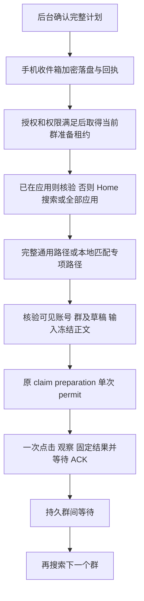

# 企业微信群消息：无环境前置的批量执行 v5

v5 将后台业务配置、完整指令投递和手机本地执行分开。管理员可以给离线手机排队，不需要安装快照、应用实例绑定或企业微信版本登记。首期业务是企业微信群纯文本；微信、钉钉、抖音尚未实现相应执行器。

## 首次准备

1. 平台管理员登记手机，使用短码配对；启用设备并绑定业务账号。业务账号及群使用人工核对过的**界面可见资料**，包括企业、账号名、完整群名、群类型及必要的辅助资料。
2. 手机选择“企业微信批量任务 v5”，完成手机端业务授权，确认服务地址、账号、学校及企业微信群消息用途。旧 v4 安装绑定授权不会自动扩大为 v5 授权。
3. 平台发布可复用的完整流程，学校管理员在“执行设备与账号”勾选历史核对确认，启用 v5。开关默认关闭；关闭开关会阻止后续执行资格，历史结果仍可恢复。
4. 打开通知和无障碍权限，保持手机解锁。这些条件影响实际界面执行，不影响后台保存和排队。授权有效且本机暂停时仍可接收任务；撤销授权后不接收新计划。

本系统中的设备、账号和群 ID 只用于授权、路由和账本关联。它们不是企业微信可查询的外部 ID，不能用来定位企业微信页面。界面匹配不使用外部群 ID、控件 resource ID 或固定坐标。标题中的 `(2)` 等成员数按标题规则解析，不能当群名的一部分随意替换。

## 管理员发送三步

1. **选择范围**：在“执行设备与账号”选择已发布流程，勾选手机或设备组批量分配。组在操作时展开为明确成员，后来增删成员不会扩大已确认任务。离线或旧协议设备可配置，实际执行需升级为 v5。
2. **填写消息**：在“配置消息”选择执行分配、各手机负责的有序群及正文。一个批次中的同一群只能归属一个执行者，不能把同一群清单广播给多台手机。群间隔可延长，不能小于已冻结政策及真实人工基准的下限。
3. **核对确认**：核对设备、账号、群、正文、顺序和间隔，确认后生成批次、子任务和不可变计划。重复确认同一幂等请求返回原结果。

“批次进度”可查看每台设备、当前群和原发送账本，执行暂停、恢复、停止。流程发布或后续分配变化不会改写在途计划；撤销旧发布会阻止其继续执行。批次停止不能撤回已经发送的消息。

## 手机实际执行

未知版本、版本读取失败或无专项匹配时直接执行完整通用流程。允许降级的未发送导航错误可以转通用路径，但共享尝试、动作、滚动和总时间预算。账号/群歧义、草稿冲突、正文改变和可能已发不能降级重试。准备租约过期后停止界面动作；续约成功才延长本地单调时钟期限。

前群成功结果 ACK 和持久等待完成前，不为后群搜索或准备。旧协议未决请求、结果、unknown 核对和等待优先恢复；恢复报文保持原协议、地址、幂等键和 body。不会把 v1—v4 的在途任务改成 v5。

## 平台维护完整流程

“规则与政策中心”包含可复用流程、真实人工基准、验证和失败记录。普通管理员不编辑 JSON、选择器或环境 UUID。

1. 在有学校管理权限的维护范围内选择试验手机。首次还没有流程时，可直接发起人工计时，填写应用名称和包身份；手机维护 APK 明确接受后，由人工真实操作采集计时。
2. 从真实成功计时记录建立基准，采用样本中较慢的值。不能填写一个样本数冒充计时；不能用自动执行耗时代替人工样本。
3. 通过页面、角色、非 ID 条件、导航步骤、桌面搜索/全部应用和预算卡片建立流程。业务政策可选已有政策组件；新政策由维护表单建立。保存不可变版本不会修改已发布版本。
4. 对该版本发起完整页面角色核验及每条非空桌面路径的测试打开。专项分支也必须验证；测试打开强制实际返回桌面走所选路径。维护验证仅用于平台集中适配，不要求每台业务手机或每个应用版本都做一遍。
5. 选择成功的通用角色验证发布到学校。发布检查全部必需证据，缺少真实证据不提供可执行的默认企业微信规则。合成 fixtures 只用于测试，不能作为正式适配证据。

维护 APK 才开放角色核验和人工计时工具，业务 APK 不开放采样入口。维护必须显式本机接受，不能抢占业务 UI 租约。

## 失败与剩余项

正常心跳、收件箱、准备和成功结果不上传实际应用、桌面或 Android 版本。实际执行失败先固定最小失败报文，再尽力读取诊断；读取失败仍可补报。补充诊断使用关联失败的独立事件，不能改写已发出的失败 body。默认不上传聊天正文、全屏截图或整机应用列表。

失败按流程、路径、检查点和原因产生稳定指纹，版本辅助排查。平台优先改善完整通用规则，再集中验证发布并批量分配给后续任务。权限不足、锁屏和网络等待不等同于页面适配失败。

对暂停批次重新执行剩余群时，先更新相应分配为所选新发布，再使用“仅重建确定未发剩余项”，重新查看预览并确认。存在未决 claim/permit 或 unknown 必须先闭合、核对。成功项、unknown 及有可能发送的项不会进入重建；新计划保留原批次关联和共享同文账本，不通过换批次绕过去重。

## 接口与迁移

v5 结构已合并到 `202610310104_automation.sql` 初始化基线，空白 schema 启动时自动建立。旧分段迁移库不自动转换，先按 [数据库重建说明](docker.md#开发数据库重建与残留对象错误) 完整重建。该基线包含流程、基准、设备组、执行分配、批次、冻结计划、投递、准备租约、事件、失败、业务授权及验证表；复用原任务项、claim、单次 permit、发送额度和结果账本。

管理接口使用现有浏览器身份、学校范围、CSRF 和稳定 `Idempotency-Key`：

| 范围 | 资源 |
| --- | --- |
| `/api/v1/platform` | `automation-flows`、`automation-pacing-profiles`、`automation-flow-releases`、`automation-execution-failures` |
| `/api/v1/schools/{school}` | `automation-device-groups`、`automation-execution-assignments`、`automation-dispatch-settings`、`automation-dispatch-previews`、`automation-dispatch-batches`、`automation-flow-validations`、`automation-execution-failures` |

手机使用专用凭据和 `/api/v5/device-execution`，不携带浏览器身份：

| 入口 | 用途 |
| --- | --- |
| `task-inbox` | 读取完整冻结计划，接收与 UI 条件分离 |
| `task-deliveries/{id}/receipts` | 落盘后的接收确认 |
| `task-deliveries/{id}/preparation-leases`、`events` | 当前群准备代次及实际路径 |
| `claims`、`claims/{id}/preparations`、`permits`、`results` | 原发送账本的 v5 校验分支 |
| `task-deliveries/{id}/failures`、`diagnostics` | 固定失败及关联诊断补充 |
| `execution-authorization-context`、`execution-authorizations` | 独立业务授权及固定回执 |
| `flow-validations`、`/{id}/acceptances`、`/{id}/events` | 明确接受的集中维护验证 |

管理端升级和迁移先部署，再升级 Otter 并制作真实流程。灰度停止时关闭 v5 开关并暂停/停止批次，保留结果和失败补报接口。不要删除新表，不要用旧端解释 v5 本地日志。

## 验证边界

常规检查为 `make check-web`、`devbox run -- make check-backend`。集成测试仅接受显式隔离的 `WEKEEPER_TEST_DATABASE_URL`，执行 `make test-integration`。新用例会在隔离 schema 将旧环境表和安装绑定表改名，确保 v5 确认、收件箱和准备不偷读旧环境依赖。

正式开放前还必须在真实 Android 桌面和至少两个企业微信版本验收：应用内/外起步、搜索与全部应用、未知版本通用流程、专项失败后通用成功、两群 ACK 后等待、停止、断网、重启和 unknown。编译、合成节点和数据库 SQL 准备检查不能代替真机验收。
